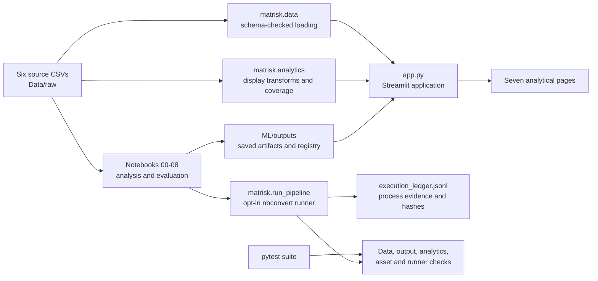

# MatRisk AI — Scientific & Financial Intelligence Platform

MatRisk AI is a local research dashboard for exploring relationships among material-property records, commodity-market histories, infrastructure observations, exposure summaries, and sustainability indicators. It brings those supplied datasets and saved notebook analyses into one place so a user can inspect the evidence, assumptions, and data limitations together.

The supplied project brief frames the broader educational objective as connecting materials science with financial risk analysis. It also proposes advanced models and a gamified simulation. The current repository is a narrower, tabular analytics prototype: its descriptive views, experimental baseline evaluations, and heuristic candidate ranking are implemented; the proposed physics-informed or crystal-structure models, calibrated failure forecasts, generative design system, and simulation game are not. The dashboard is not an autonomous decision system or a validated predictive platform.

## Contents

- [Author](#author)
- [Objectives and scope](#objectives-and-scope)
- [Dashboard pages](#dashboard-pages)
- [Datasets](#datasets)
- [Architecture](#architecture)
- [Setup and use](#setup-and-use)
- [Notebook pipeline and execution ledger](#notebook-pipeline-and-execution-ledger)
- [Testing and verification](#testing-and-verification)
- [Scientific limitations and responsible use](#scientific-limitations-and-responsible-use)
- [Repository structure](#repository-structure)
- [Troubleshooting](#troubleshooting)
- [Future work](#future-work)
- [License and acknowledgements](#license-and-acknowledgements)

## Author

| | |
|---|---|
| **Author** | Amey Ravindra Pandit |
| **Academic affiliation** | Department of Information Technology |
| **Institution** | Finolex Academy of Management and Technology |
| **Location** | Ratnagiri, Maharashtra, India |
| **Program** | Bachelor of Engineering (B.E.) in Information Technology |
| **Project** | MatRisk AI — Scientific & Financial Intelligence Platform |
| **Contact** | [ameypandit36@gmail.com](mailto:ameypandit36@gmail.com) |

## Objectives and scope

The prototype is intended to help students, researchers, and technical reviewers investigate how materials data and market or infrastructure records might be viewed together. It provides source-data inspection, descriptive summaries, saved model-evaluation results, and explicit caveats. It does not establish operational decisions or replace domain review.

The original project brief describes a broader vision involving crystal-structure encoding, physics-informed modelling, inverse material design, survival analysis, and a gamified portfolio simulator. Those are proposal concepts, not current repository capabilities. The implemented work uses the six local CSV snapshots, tabular machine-learning baselines in notebooks, curated saved outputs, and a seven-page Streamlit interface.

The application separates four kinds of evidence:

- **Descriptive analytics:** counts, distributions, time series, joins, and source-field aggregations.
- **Experimental modelling:** saved held-out or grouped evaluation results, including baseline comparisons.
- **Heuristic screening:** relative scoring of existing material records using the notebook's stated constraints and weights.
- **Validated prediction:** not established by the current evidence. No dashboard result should be interpreted as a validated operational forecast.

## Dashboard pages

The application is `app.py`. Its persistent sidebar contains the MatRisk AI brand and seven native Streamlit navigation destinations. Page-level module icons and visual styling are local assets in [`assets/`](assets/).

| Page | Purpose and controls / visualizations | Sources and limitations |
|---|---|---|
| **Overview** | Summary of source/artifact availability, model-selection status, current evidence brief, and links to Materials and Infrastructure pages. | Reads DS1, DS3, Notebook 02 results, Notebook 05 exposure, and the Notebook 08 registry. Registry presence and readability do not establish freshness. |
| **Materials Intelligence** | Search material formula/ID, filter crystal system and stability, inspect finite-value distributions and record details, and rank eligible existing candidates using the saved cost/property heuristic. | DS1, price coverage sources DS1/DS5, and Notebook 07 ranking outputs. No crystal structures are supplied; the ranking is not generated design or suitability validation. |
| **Commodity Intelligence** | Select a commodity and inclusive date window; view individual prices, indexed comparisons, or small multiples. Review saved chronological holdout metrics, actual-versus-predicted returns, split boundaries, and residuals. | DS2 and DS4 features; Notebook 03 outputs. The selected commodity baseline is zero-return and has not demonstrated useful predictive skill or profitability. |
| **Infrastructure Risk** | Filter documented condition ratings, inspect rating summaries and raw out-of-scale records, review source-field exposure totals, and explore user-selected hypothetical gross-loss fractions. | DS3, DS6, Notebook 04 model outputs, and Notebook 05 exposure summaries. Cross-sectional records do not support survival or remaining-useful-life estimates; stress fractions are assumptions, not probabilities. |
| **ESG & Sustainability** | Choose date ranges, inspect element prices in USD/kg or indexed to a series base, review complete-price coverage, and explore commodity-level carbon indicators. | DS1 and DS5 for formula-price coverage; Notebook 06 artifacts; DS4 carbon-intensity fields. Coverage is incomplete and these indicators are not material-specific life-cycle assessments. |
| **Model Laboratory** | Inspect selected material models, grouped cross-validation/test metrics, commodity validation and chronological test splits, and infrastructure condition holdout diagnostics where saved IDs/columns permit. | Notebook 02, Notebook 03, and Notebook 04 outputs. Tasks use different targets, samples, and units; their metrics are not directly comparable. |
| **Data Quality & Runs** | Inspect source-file presence, minimum-schema readability, configured data-quality warnings, artifact presence/readability, registry summaries, and execution-ledger status when a ledger exists. | Six DS CSVs and Notebook 08 / optional runner ledger. Unknown freshness remains unknown; file presence is not evidence of a current notebook run. |

## Datasets

The application reads the six CSVs under [`Data/raw/`](Data/raw/). The filenames, row and column counts, and field names below were checked against the current files. The project includes [`ReadME for Dataset.docx`](Data/raw/ReadME%20for%20Dataset.docx) and [`MatRisk_AI_Sample_Datasets.xlsx`](Data/raw/MatRisk_AI_Sample_Datasets.xlsx) as accompanying data notes/examples. Those notes describe intended use, but the repository does not provide independently verifiable source URLs or record-level provenance for the six current CSV snapshots. No claim is made that the current records were downloaded from the named external databases/providers in the project brief.

### Source inventory

| Dataset | Current file | Rows × columns | Fields and units |
|---|---|---:|---|
| **DS1 — Material properties** | [`DS1_material_properties_5500.csv`](Data/raw/DS1_material_properties_5500.csv) | 5,500 × 18 | `material_id`, `formula`, `n_elements`, `crystal_system`, `spacegroup_number`, `category`, `formation_energy_per_atom_eV`, `energy_above_hull_eV`, `band_gap_eV`, `is_metal`, `bulk_modulus_GPa`, `shear_modulus_GPa`, `poisson_ratio`, `density_g_cm3`, `nsites`, `volume_A3`, `melting_point_K`, `is_stable`. Units are encoded in applicable field names: eV/atom, eV, GPa, g/cm³, ų, K; flags and identifiers are categorical/Boolean. |
| **DS2 — Commodity prices** | [`DS2_commodity_prices_10yr.csv`](Data/raw/DS2_commodity_prices_10yr.csv) | 22,952 × 24 | `date`, `commodity`, `open`, `high`, `low`, `close`, `volume`, `daily_return`, `return_5d`, `return_21d`, `volatility_5d_ann`, `volatility_21d_ann`, `volatility_63d_ann`, `sma_21`, `sma_63`, `bollinger_upper`, `bollinger_lower`, `bollinger_z`, `rsi_14`, `macd`, `macd_signal`, `momentum_10d`, `momentum_21d`, `term_spread`. The current CSV does not carry a per-commodity unit/currency dictionary; do not assume all price and volume fields share units. |
| **DS3 — Infrastructure bridge records** | [`DS3_infrastructure_bridges_5000.csv`](Data/raw/DS3_infrastructure_bridges_5000.csv) | 5,000 × 24 | `bridge_id`, `bridge_type`, `material`, `year_built`, `age_years`, `design_life_years`, `location`, `corrosion_environment`, `corrosion_rate_mm_yr`, `condition_rating`, `structurally_deficient`, `adt`, `deck_area_sqft`, `tensile_strength_MPa`, `yield_strength_MPa`, `paris_C`, `paris_m`, `original_thickness_mm`, `remaining_thickness_mm`, `fatigue_cycles_millions`, `replacement_cost_M`, `loan_outstanding_M`, `last_inspection_date`, `insurance_premium_K_yr`. Field suffixes indicate the stated physical units and scale; the source does not document the currency represented by financial `_M`/`_K` values. |
| **DS4 — Cross-domain daily features** | [`DS4_crossdomain_features_daily.csv`](Data/raw/DS4_crossdomain_features_daily.csv) | 22,952 × 12 | `date`, `commodity`, `mqi`, `supply_disruption_prob`, `substitution_elasticity`, `green_premium_per_kg`, `carbon_intensity_virgin`, `carbon_intensity_recycled`, `herfindahl_index`, `mqi_5d_trend`, `mqi_21d_trend`, `mqi_63d_trend`. Several names imply dimensionless values or a per-kg value, but the current CSV lacks a complete unit/provenance dictionary; unspecified units should not be inferred. |
| **DS5 — Element prices** | [`DS5_element_prices_monthly.csv`](Data/raw/DS5_element_prices_monthly.csv) | 5,280 × 5 | `date`, `element`, `price_usd_per_kg`, `base_price`, `monthly_return`. Price is USD/kg as encoded; the file has 40 elements over 132 months. The units/scaling of `base_price` are not separately documented. |
| **DS6 — Historical failure events** | [`DS6_historical_failures_2000.csv`](Data/raw/DS6_historical_failures_2000.csv) | 2,000 × 18 | `event_id`, `event_year`, `structure_type`, `material`, `location`, `corrosion_environment`, `age_at_event_years`, `corrosion_rate_mm_yr`, `failure_mode`, `severity`, `replacement_value_USD`, `repair_cost_USD`, `loss_ratio`, `detected_by`, `was_predicted`, `warning_lead_months`, `insurance_claim_filed`, `regulatory_action`. Currency suffixes identify USD; corrosion rate is mm/year and warning lead is in months. These are event records, not an exposed population with non-failure observations. |

### Data quality and alignment

- Current DS1 has no missing cells, but has 21 repeated `material_id` rows noted by the supplied audit documentation. The material notebook also reports physical consistency/stability-label discrepancies; inspect the audit outputs before interpretation.
- DS2 and DS4 each contain 22,952 unique `(date, commodity)` keys and no missing key cells. Their exact inner join matches all **22,952** keys, with zero unmatched records on either side. Both cover 2,869 dates from 2014-01-02 to 2024-12-31 and the same eight commodity names. DS2's leading-window null counts include 8 for `daily_return`, 40 for the 5-day return/volatility fields, 168 for the 21-day return/volatility fields, 504 for 63-day volatility, 160 for 21-day averages/Bollinger bands, 496 for 63-day averages/`bollinger_z`, 112 for RSI, 80 for 10-day momentum, and 168 for 21-day momentum. DS4 has 40, 168, and 504 nulls in the 5-, 21-, and 63-day MQI trend fields, respectively. These are pre-existing rolling-window gaps; they are not filled by the join.
- DS3 contains five `condition_rating = 0` records outside the documented integer 1–9 scale. The Infrastructure Risk page excludes those records from condition summaries/charts and keeps them accessible in a raw-record quality expander.
- DS3, DS5, and DS6 have no missing cells in the current snapshots. DS5 has 5,280 complete rows (40 elements × 132 months as described in the supplied dataset note). DS6 has 2,000 event rows and the supplied project audit notes 85 repair-cost values above replacement value; this requires investigation and is not silently corrected.
- **Elemental-price coverage:** the current app parses flat chemical formula strings, then checks whether every parsed element has a positive price on the latest date with usable positive prices. With current DS1/DS5 data, the numerator is **1,795** completely covered material rows out of **5,500** (32.636%, displayed as **32.6%**), using latest date **2024-12-01** and 40 available elements. Grouped/charged formula syntax is not inferred. Coverage does not constitute a complete material cost estimate or life-cycle assessment.

## Architecture



The application uses Python, Streamlit, Pandas, NumPy, and Altair charts (available through the Streamlit dependency set). The notebooks use Pandas, NumPy, Matplotlib, and scikit-learn for tabular analysis and baselines. [`requirements.txt`](requirements.txt) is the dependency manifest. [`matrisk/data.py`](matrisk/data.py) resolves the project root and checks minimum dataset schemas; [`matrisk/analytics.py`](matrisk/analytics.py) contains deterministic plotting transforms, indexed series, condition-rating filtering, and price-coverage logic. Notebook artifacts are stored under `ML/outputs/`; historical Notebook 00/01 outputs also exist under `ML/notebooks/outputs/`. [`assets/ASSET_MANIFEST.md`](assets/ASSET_MANIFEST.md) documents the local SVG brand, module icons, and overview background.

## Setup and use

### Prerequisites

- Windows 10/11 or another supported Python environment.
- Python compatible with the packages in [`requirements.txt`](requirements.txt) (Python 3.11+ is a suitable current environment).
- The project directory containing `app.py`, `Data/`, and `ML/`.

### Windows PowerShell

Open PowerShell and change to the project root (the directory containing `app.py`):

```powershell
Set-Location "C:\path\to\MAT Risk"
py -3 -m venv .venv
.\.venv\Scripts\Activate.ps1
python -m pip install --upgrade pip
python -m pip install -r requirements.txt
```

If PowerShell blocks activation under the machine's execution policy, use the environment's interpreter directly instead:

```powershell
.\.venv\Scripts\python.exe -m pip install -r requirements.txt
.\.venv\Scripts\python.exe -m streamlit run app.py
```

Check that `Data/raw/` contains the six `DS*.csv` files listed above and that `ML/outputs/` contains the saved notebook artifacts. Missing outputs are reported as unavailable; the app does not execute notebooks automatically. Start the app from the project root:

```powershell
python -m streamlit run app.py
```

Streamlit prints the local URL in the terminal. To use a different port if the default is occupied, run `python -m streamlit run app.py --server.port 8502`. When launching from another working directory, set `MATRISK_PROJECT_ROOT` to the checkout containing `Data/` and `ML/`.

## Notebook pipeline and execution ledger

The nine notebooks under [`ML/notebooks/`](ML/notebooks/) have these roles:

| Notebook | Role |
|---|---|
| `00_dataset_inventory_and_quality_audit.ipynb` | Inventory source files, profile schemas, and report data-quality findings. |
| `01_ds1_material_properties_baseline_tested.ipynb` | Test DS1 tabular property baselines and data/physical checks. |
| `02_materials_feature_engineering_model_selection_updated.ipynb` | Engineer composition features and compare grouped material-property models with baselines. |
| `03_commodity_forecasting_cross_domain_ablation.ipynb` | Evaluate chronological commodity-return baselines and DS4 cross-domain ablation inputs. |
| `04_infrastructure_condition_risk_modelling_corrected.ipynb` | Evaluate cross-sectional bridge condition models and save diagnostics. |
| `05_financial_exposure_expected_loss_insurance_risk.ipynb` | Summarize bridge exposure and hypothetical stress sensitivity from available fields. |
| `06_esg_element_price_coverage_tested.ipynb` | Recalculate formula-to-element price coverage and commodity-level carbon indicators. |
| `07_inverse_material_design_cost_constrained_ranking.ipynb` | Rank eligible existing material rows with a cost/property heuristic. |
| `08_consolidated_evaluation_reproducibility_registry.ipynb` | Inventory expected artifacts, readability checks, and model metrics. |

The optional project runner executes notebooks in dependency order and **in place** using Jupyter `nbconvert`:

```powershell
python -m matrisk.run_pipeline
```

It can be computationally expensive, updates notebook files, and writes outputs. Review the relevant notebook code and expected effects before starting a full run. To run one notebook, pass its exact filename, for example `python -m matrisk.run_pipeline 01_ds1_material_properties_baseline_tested.ipynb`; `--timeout 900` sets the cell timeout in seconds.

The runner appends JSON Lines to `ML/outputs/execution_ledger.jsonl`. Records include run ID, UTC timestamps, process return status/code, command, raw CSV SHA-256 hashes, input changes compared with that notebook's previous ledger record, Git revision if available, expected and missing output paths, files changed during the invocation, and failure details. Status means process outcome only: nonzero exit is `failure`, timeout is `interrupted`, and exit code zero is `success`. Output evidence is separate: pre-existing artifacts are not counted as generated by the run, and missing expected outputs remain visible. A successful notebook process does not certify artifact freshness, output correctness, or scientific validity. The current checkout has no acceptance-run ledger; do not infer a recent run from saved artifacts.

## Testing and verification

Run the automated suite from the project root:

```powershell
python -m pytest -q
```

The latest recorded suite result for this code is **22 passed, 0 failed, 0 skipped**. Tests cover dataset schemas and saved-output contracts, analytics edge cases, asset availability, sidebar navigation cleanup, and safe simulated notebook-runner success/failure/interruption/output/input-hash records. Run the suite again after changing code or data.

Automated tests do not establish model validity. Streamlit AppTest can verify page execution and interactions at the application level; it does not check real browser rendering or responsive layout. A live browser visual inspection was not completed in the current managed environment because Windows denied the localhost socket request. The notebook pipeline was not run as part of the latest acceptance pass. Scientific validation requires independent data provenance, domain-appropriate methods, representative evaluation, and external review beyond these tests.

## Scientific limitations and responsible use

> **Research prototype only.** Do not use dashboard values as financial, engineering, safety, insurance, or regulatory decisions without independent validation and domain review.

- Grouped evaluation selects mean (`DummyMean`) baselines for all four reported materials targets. The available evidence does not establish useful out-of-group composition-only predictions.
- Commodity evaluation selects a zero-return baseline. Its held-out result does not demonstrate useful predictive skill, trading profitability, or financial certainty.
- Bridge analysis is cross-sectional; it does not establish asset survival curves, remaining useful life, or calibrated failure forecasts.
- DS6 contains failure events without a non-failure exposure cohort. It does not establish population failure probabilities, calibrated insurance risk, or actuarial expected loss.
- Elemental price coverage is incomplete (32.6% under the current rule). The resulting price proxy omits manufacturing, processing, energy, transport, waste, and lifecycle costs.
- DS4 carbon fields are commodity-level indicators, not a material-specific or complete life-cycle assessment.
- The candidate ranking is heuristic screening over existing records, not generative material design, suitability certification, or experimental validation.
- Artifact presence and registry readability do not prove freshness, successful producer execution, or scientific validity.
- Exact DS2/DS4 date/commodity alignment supports a descriptive joined view only. It does not establish causal relationships or point-in-time feature availability.
- Several source fields lack complete unit or provenance metadata. Interpret only documented units; do not infer currency or scale from field names alone.

## Repository structure

```text
MAT Risk/
├── app.py
├── README.md
├── IMPLEMENTATION_REPORT.md
├── requirements.txt
├── assets/
│   ├── ASSET_MANIFEST.md
│   ├── backgrounds/             # Overview SVG background
│   ├── brand/                   # Logo, mark, favicon
│   └── icons/                   # Seven page icons
├── Data/
│   └── raw/
│       ├── DS1_material_properties_5500.csv
│       ├── DS2_commodity_prices_10yr.csv
│       ├── DS3_infrastructure_bridges_5000.csv
│       ├── DS4_crossdomain_features_daily.csv
│       ├── DS5_element_prices_monthly.csv
│       ├── DS6_historical_failures_2000.csv
│       ├── MatRisk_AI_Sample_Datasets.xlsx
│       └── ReadME for Dataset.docx
├── initial doc/                 # Supplied original project brief PDF
├── matrisk/
│   ├── analytics.py
│   ├── data.py
│   └── run_pipeline.py
├── ML/
│   ├── README.md
│   ├── notebooks/               # Notebooks 00–08 and historical outputs
│   └── outputs/                 # Saved analysis, audit, and registry artifacts
└── tests/
    ├── test_analytics.py
    ├── test_assets.py
    ├── test_data.py
    ├── test_pipeline_outputs.py
    └── test_run_pipeline.py
```

The tree summarizes generated output directories; it does not enumerate every artifact. Notebooks may create additional files under the output folders when executed.

## Troubleshooting

- **Project root not found / files appear missing:** start the command from the directory containing `app.py`, `Data/`, and `ML/`. For another working directory, set `$env:MATRISK_PROJECT_ROOT = "C:\path\to\MAT Risk"` before launching.
- **Dataset warning or page unavailable:** confirm the expected CSV exists under `Data/raw/` and has the required header. The app performs minimum-schema checks and does not repair source records.
- **Saved chart or result missing:** confirm the corresponding file exists under `ML/outputs/`. The app reports missing output evidence; it does not silently regenerate it. Re-run only the required notebook after reviewing its effects.
- **Dependency installation fails:** activate the project virtual environment, upgrade pip, and retry `python -m pip install -r requirements.txt`. Check Python compatibility and network/proxy access if pip cannot resolve packages.
- **Streamlit port is in use:** select another port, for example `python -m streamlit run app.py --server.port 8502`.
- **Notebook execution fails:** inspect the failing notebook cell and error, verify its input datasets and dependencies, and rerun dependent notebooks in order. Check `execution_ledger.jsonl` when using the runner; `failure` and `interrupted` statuses record process outcomes, not the validity of previous artifacts.
- **Freshness or execution status is unknown:** this is intentional when no current ledger evidence exists. Existing artifacts and the Notebook 08 inventory do not establish a successful recent producer run.

## Future work

Consistent with the original brief and current limitations, potential future work includes documenting dataset provenance and units, repeating grouped and chronological model evaluation, improving out-of-group generalization, testing time-valid cross-domain feature availability, building appropriate non-failure/exposure cohorts before survival or population-risk work, and validating assumptions with domain specialists. Crystal-structure models, physics-informed constraints, generative design, and a gamified simulation would require additional data, dependencies, methods, and dedicated validation; they remain proposed scope rather than implemented features.

## License and acknowledgements

No `LICENSE` file is present in this repository, so reuse and redistribution terms are not specified here. The supplied original project brief is marked private/confidential; this README summarizes its broad educational intent without republishing its detailed contents. The repository does not include sufficient source metadata to acknowledge a verified external provider for each current CSV dataset. The project-level data notes identify intended fields and analytical uses, not independently confirmed provenance.
