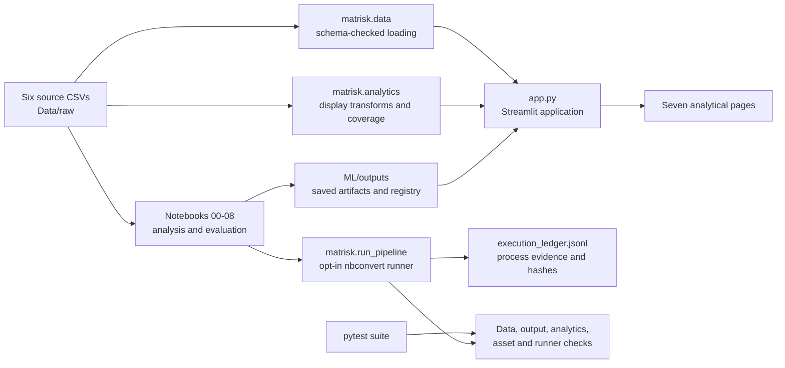

# MatRisk AI — Scientific & Financial Intelligence Platform

MatRisk AI is a local research dashboard that brings materials-property records, commodity histories, infrastructure observations, exposure summaries, and sustainability indicators into a single workspace. It helps users inspect source data, compare saved notebook evaluations, and explore analytical assumptions alongside their limitations.

[**Open the live application**](https://matrisk-ai-rrwtauduv5p8qqtpljhe5e.streamlit.app/) · [Implementation report](IMPLEMENTATION_REPORT.md) · [Notebook guide](ML/README.md)

<p align="center">
  
</p>

*Illustrative project overview. The infographic is not a live dashboard capture or a statement of data provenance; implemented capabilities and evidence limits are documented below.*

## Contents

- [Overview and scope](#overview-and-scope)
- [Dashboard pages](#dashboard-pages)
- [Technology stack](#technology-stack)
- [Datasets and data sources](#datasets-and-data-sources)
- [Architecture and data workflow](#architecture-and-data-workflow)
- [Installation and local execution](#installation-and-local-execution)
- [Notebook pipeline and execution ledger](#notebook-pipeline-and-execution-ledger)
- [Testing and validation](#testing-and-validation)
- [Scientific limitations and responsible use](#scientific-limitations-and-responsible-use)
- [Project structure](#project-structure)
- [Troubleshooting](#troubleshooting)
- [Future improvements](#future-improvements)
- [Acknowledgements and license](#acknowledgements-and-license)
- [Author](#author)

## Overview and scope

The prototype is intended for students, researchers, and technical reviewers investigating how materials data can be considered alongside market and infrastructure records. It provides source-data inspection, descriptive summaries, saved model-evaluation results, and heuristic screening. It does not make autonomous decisions or provide validated operational predictions.

The supplied project brief describes a broader educational vision connecting materials science and financial risk, including crystal-structure and physics-informed models, inverse design, survival analysis, and a gamified portfolio simulator. Those are proposed concepts, not current repository capabilities. This implementation is a narrower tabular analytics prototype built around six local CSV snapshots, experimental baselines, saved outputs, and a seven-page Streamlit interface.

The application distinguishes:

- **Descriptive analytics:** counts, distributions, time series, joins, and source-field aggregations.
- **Experimental modelling:** saved grouped or chronological evaluations, including baseline comparisons.
- **Heuristic screening:** relative scoring of existing material records using notebook-stated constraints and weights.
- **Validated prediction:** not established by the current evidence. Results are not validated operational forecasts.

## Dashboard pages

The application entry point is [`app.py`](app.py). Its persistent sidebar uses a native Streamlit radio control for the seven destinations. Page icons and styling use local SVG assets documented in [`assets/ASSET_MANIFEST.md`](assets/ASSET_MANIFEST.md).

| Page | Purpose and controls / visualizations | Sources and limitations |
|---|---|---|
| **Overview** | Summarizes source and artifact availability, model-selection status, current evidence, and links to Materials and Infrastructure pages. | Reads DS1, DS3, Notebook 02 results, Notebook 05 exposure, and the Notebook 08 registry. Registry presence and readability do not establish freshness. |
| **Materials Intelligence** | Search by formula/ID, filter crystal system and stability, inspect finite-value distributions and records, and rank eligible existing candidates with the saved cost/property heuristic. | DS1, DS1/DS5 price coverage, and Notebook 07. No crystal structures are supplied; this is neither generated design nor suitability validation. |
| **Commodity Intelligence** | Select a commodity and inclusive date window; view individual prices, indexed comparisons, or small multiples. Review saved chronological holdout metrics, actual-versus-predicted returns, split boundaries, and residuals. | DS2, DS4 features, and Notebook 03. The selected baseline is zero-return and has not demonstrated useful predictive skill or profitability. |
| **Infrastructure Risk** | Filter documented condition ratings, inspect summaries and raw out-of-scale records, review exposure totals, and explore hypothetical gross-loss fractions. | DS3, DS6, Notebook 04, and Notebook 05. Cross-sectional records do not support survival or remaining-useful-life estimates; stress fractions are assumptions, not probabilities. |
| **ESG & Sustainability** | Choose date ranges, inspect element prices in USD/kg or indexed to a series base, review complete-price coverage, and explore commodity-level carbon indicators. | DS1, DS5, Notebook 06, and DS4. Coverage is incomplete; the indicators are not material-specific life-cycle assessments. |
| **Model Laboratory** | Inspect selected material models, grouped cross-validation/test metrics, commodity validation and chronological test splits, and infrastructure condition holdout diagnostics where saved columns permit. | Notebooks 02–04. Tasks have different targets, samples, and units; metrics are not directly comparable. |
| **Data Quality & Runs** | Inspect source presence, minimum-schema readability, configured warnings, artifact presence/readability, registry summaries, and execution-ledger status when available. | Six source CSVs, Notebook 08, and the optional runner ledger. Unknown freshness remains unknown; file presence is not evidence of a current run. |

## Technology stack

| Area | Technologies and use |
|---|---|
| Application | Python and Streamlit; Altair charts (available through Streamlit's dependency set). |
| Data and analytics | Pandas and NumPy for loading and transformations; deterministic chart preparation in `matrisk/analytics.py`. |
| Notebook analysis | Jupyter, Matplotlib, and scikit-learn for tabular baseline evaluation and saved diagnostics. |
| Local presentation | Original SVG logo, favicon, page icons, and overview background under `assets/`; custom CSS in `app.py`. |
| Validation | pytest checks schemas, output contracts, analytic edge cases, assets, navigation cleanup, and runner logging behavior. |

[`requirements.txt`](requirements.txt) is the dependency manifest. [`matrisk/data.py`](matrisk/data.py) resolves the project root and checks minimum dataset schemas. [`matrisk/analytics.py`](matrisk/analytics.py) contains histogram preparation, indexed series, condition-rating filtering, and elemental price coverage. The Streamlit app reads saved notebook outputs; it does not execute notebooks on page load.

## Datasets and data sources

The app reads six CSV snapshots from [`Data/raw/`](Data/raw/). Current filenames, row/column counts, and fields are checked against the files in this checkout. The folder also contains [`ReadME for Dataset.docx`](Data/raw/ReadME%20for%20Dataset.docx) and [`MatRisk_AI_Sample_Datasets.xlsx`](Data/raw/MatRisk_AI_Sample_Datasets.xlsx) as data notes/examples. They describe intended use, but the repository does not provide independently verifiable source URLs or record-level provenance for the six current CSV snapshots. This README does not attribute those records to the external databases or providers named in the project brief.

### Dataset inventory

| Dataset | File | Rows × columns | Fields and units |
|---|---|---:|---|
| **DS1 — Material properties** | [`DS1_material_properties_5500.csv`](Data/raw/DS1_material_properties_5500.csv) | 5,500 × 18 | `material_id`, `formula`, `n_elements`, `crystal_system`, `spacegroup_number`, `category`, `formation_energy_per_atom_eV`, `energy_above_hull_eV`, `band_gap_eV`, `is_metal`, `bulk_modulus_GPa`, `shear_modulus_GPa`, `poisson_ratio`, `density_g_cm3`, `nsites`, `volume_A3`, `melting_point_K`, `is_stable`. Applicable units encoded in fields: eV/atom, eV, GPa, g/cm³, ų, K; other fields are identifiers, categories, or flags. |
| **DS2 — Commodity prices** | [`DS2_commodity_prices_10yr.csv`](Data/raw/DS2_commodity_prices_10yr.csv) | 22,952 × 24 | `date`, `commodity`, `open`, `high`, `low`, `close`, `volume`, `daily_return`, `return_5d`, `return_21d`, `volatility_5d_ann`, `volatility_21d_ann`, `volatility_63d_ann`, `sma_21`, `sma_63`, `bollinger_upper`, `bollinger_lower`, `bollinger_z`, `rsi_14`, `macd`, `macd_signal`, `momentum_10d`, `momentum_21d`, `term_spread`. No per-commodity unit/currency dictionary is included; do not assume all price or volume fields share units. |
| **DS3 — Infrastructure bridge records** | [`DS3_infrastructure_bridges_5000.csv`](Data/raw/DS3_infrastructure_bridges_5000.csv) | 5,000 × 24 | `bridge_id`, `bridge_type`, `material`, `year_built`, `age_years`, `design_life_years`, `location`, `corrosion_environment`, `corrosion_rate_mm_yr`, `condition_rating`, `structurally_deficient`, `adt`, `deck_area_sqft`, `tensile_strength_MPa`, `yield_strength_MPa`, `paris_C`, `paris_m`, `original_thickness_mm`, `remaining_thickness_mm`, `fatigue_cycles_millions`, `replacement_cost_M`, `loan_outstanding_M`, `last_inspection_date`, `insurance_premium_K_yr`. Physical units/scales are indicated by applicable suffixes; currency for `_M`/`_K` fields is undocumented. |
| **DS4 — Cross-domain daily features** | [`DS4_crossdomain_features_daily.csv`](Data/raw/DS4_crossdomain_features_daily.csv) | 22,952 × 12 | `date`, `commodity`, `mqi`, `supply_disruption_prob`, `substitution_elasticity`, `green_premium_per_kg`, `carbon_intensity_virgin`, `carbon_intensity_recycled`, `herfindahl_index`, `mqi_5d_trend`, `mqi_21d_trend`, `mqi_63d_trend`. The CSV lacks a complete unit/provenance dictionary; do not infer unspecified units from field names. |
| **DS5 — Element prices** | [`DS5_element_prices_monthly.csv`](Data/raw/DS5_element_prices_monthly.csv) | 5,280 × 5 | `date`, `element`, `price_usd_per_kg`, `base_price`, `monthly_return`. Price is USD/kg as encoded; 40 elements over 132 months. `base_price` units/scaling are not separately documented. |
| **DS6 — Historical failure events** | [`DS6_historical_failures_2000.csv`](Data/raw/DS6_historical_failures_2000.csv) | 2,000 × 18 | `event_id`, `event_year`, `structure_type`, `material`, `location`, `corrosion_environment`, `age_at_event_years`, `corrosion_rate_mm_yr`, `failure_mode`, `severity`, `replacement_value_USD`, `repair_cost_USD`, `loss_ratio`, `detected_by`, `was_predicted`, `warning_lead_months`, `insurance_claim_filed`, `regulatory_action`. Currency suffixes indicate USD; corrosion rate is mm/year and warning lead is months. Events alone do not provide a non-failure exposure cohort. |

### Data quality and cross-domain alignment

- **DS1:** no missing cells; 21 repeated `material_id` rows are noted by the supplied audit documentation. The material notebook also reports physical-consistency and stability-label discrepancies; inspect audit outputs before interpretation.
- **DS2 + DS4:** the documented join key is `(date, commodity)`. Each file has 22,952 unique keys, no missing key cells, and no duplicate key groups. Exact inner join: 22,952 matches, zero unmatched keys on either side. Both cover the same 2,869 dates from 2014-01-02 through 2024-12-31 and the same eight commodity names. Rolling-window nulls are pre-existing and are not filled by the join: DS2 has 8 missing `daily_return`; 40 each for 5-day return and volatility; 168 each for 21-day return and volatility; 504 for 63-day volatility; 160 each for 21-day averages and Bollinger bands; 496 each for 63-day average and `bollinger_z`; 112 for RSI; 80 for 10-day momentum; and 168 for 21-day momentum. DS4 has 40, 168, and 504 missing values in the 5-, 21-, and 63-day MQI trend fields.
- **DS3:** five condition ratings are zero, outside the documented integer range 1–9. They are excluded from applicable summaries/charts and remain available in the app's raw-record quality expander. DS3 has no missing cells.
- **DS5 and DS6:** no missing cells in these snapshots. The supplied project audit notes 85 DS6 repair-cost values above replacement value; these are not silently corrected.
- **Elemental-price coverage:** the app parses flat chemical formulas and checks whether every parsed element has a positive price on the latest date with usable positive prices. Current DS1/DS5 result: **1,795 / 5,500 material records (32.636%, displayed as 32.6%)**, latest date **2024-12-01**, with **40** elements priced on that date. Grouped or charged formula syntax is not inferred. This is not a complete material-cost estimate or life-cycle assessment.

## Architecture and data workflow



Notebook artifacts live under `ML/outputs/`; historical Notebook 00/01 outputs also exist under `ML/notebooks/outputs/`. Notebook 08 inventories expected artifacts and summary readability. The SVG inventory and purposes are documented in [`assets/ASSET_MANIFEST.md`](assets/ASSET_MANIFEST.md).

## Installation and local execution

### Prerequisites

- Windows 10/11 or another supported Python environment.
- A Python version compatible with [`requirements.txt`](requirements.txt); Python 3.11+ is a suitable current environment.
- The project root containing `app.py`, `Data/`, and `ML/`.

### Windows PowerShell setup

Run these commands from the project root:

```powershell
py -3 -m venv .venv
.\.venv\Scripts\Activate.ps1
python -m pip install --upgrade pip
python -m pip install -r requirements.txt
```

If PowerShell blocks environment activation, invoke the environment's Python directly:

```powershell
.\.venv\Scripts\python.exe -m pip install -r requirements.txt
.\.venv\Scripts\python.exe -m streamlit run app.py
```

Confirm the six source CSVs are present in `Data/raw/` and saved notebook artifacts are under `ML/outputs/`. Missing outputs appear unavailable; the app does not run notebooks automatically. From the project root, start the dashboard with:

```powershell
python -m streamlit run app.py
```

Streamlit prints the local URL in the terminal. If the default port is occupied, use `python -m streamlit run app.py --server.port 8502`. To launch from another working directory, set `MATRISK_PROJECT_ROOT` to the checkout containing `Data/` and `ML/`.

## Notebook pipeline and execution ledger

The nine notebooks under [`ML/notebooks/`](ML/notebooks/) serve these roles:

| Notebook | Purpose |
|---|---|
| `00_dataset_inventory_and_quality_audit.ipynb` | Inventory source files, profile schemas, and report data-quality findings. |
| `01_ds1_material_properties_baseline_tested.ipynb` | Test DS1 tabular property baselines and data/physical checks. |
| `02_materials_feature_engineering_model_selection_updated.ipynb` | Engineer composition features and compare grouped material-property models with baselines. |
| `03_commodity_forecasting_cross_domain_ablation.ipynb` | Evaluate chronological commodity-return baselines and DS4 feature ablations. |
| `04_infrastructure_condition_risk_modelling_corrected.ipynb` | Evaluate cross-sectional bridge-condition models and save diagnostics. |
| `05_financial_exposure_expected_loss_insurance_risk.ipynb` | Summarize bridge exposure and hypothetical stress sensitivity from available fields. |
| `06_esg_element_price_coverage_tested.ipynb` | Recalculate formula-to-element price coverage and commodity-level carbon indicators. |
| `07_inverse_material_design_cost_constrained_ranking.ipynb` | Rank eligible existing material rows with a cost/property heuristic. |
| `08_consolidated_evaluation_reproducibility_registry.ipynb` | Inventory expected artifacts, readability checks, and model metrics. |

The optional runner executes notebooks in dependency order using Jupyter `nbconvert` and modifies notebooks **in place**:

```powershell
python -m matrisk.run_pipeline
```

This can be computationally expensive and writes outputs. Review notebook code and expected effects before starting a full run. To run one notebook, pass its exact filename, e.g. `python -m matrisk.run_pipeline 01_ds1_material_properties_baseline_tested.ipynb`. Use `--timeout 900` to set the cell timeout in seconds.

The runner appends JSON Lines to `ML/outputs/execution_ledger.jsonl`. Each record includes a run ID, UTC timestamps, process status/return code, command, raw CSV SHA-256 hashes, input changes since that notebook's previous record, Git revision when available, expected and missing output paths, files changed during the invocation, and failure details. A nonzero exit is `failure`; a timeout is `interrupted`; a zero exit is `success`. Output evidence is separate: pre-existing files are not counted as generated by the current run, and missing expected outputs remain visible. Process success does not certify output correctness, freshness, or scientific validity. This checkout has no acceptance-run ledger; saved artifacts alone do not prove a recent execution.

## Testing and validation

Run automated tests from the project root:

```powershell
python -m pytest -q
```

The latest recorded result is **22 passed, 0 failed, 0 skipped**. Tests cover minimum dataset schemas, saved-output contracts, analytic edge cases, assets, sidebar navigation cleanup, and simulated notebook-runner success/failure/interruption/output/input-hash records.

Automated tests establish application and data contracts, not model validity. Streamlit AppTest can check page execution and interactions, but does not verify real-browser rendering or responsive layout. A live browser inspection was not completed in the managed environment because Windows denied the localhost socket request. The notebook pipeline was not run in the latest acceptance pass. Scientific validation requires independent provenance, domain-appropriate methods, representative evaluation, and external review beyond these checks.

## Scientific limitations and responsible use

> **Research prototype only.** Do not use dashboard values for financial, engineering, safety, insurance, or regulatory decisions without independent validation and domain review.

- Grouped evaluation selects mean (`DummyMean`) baselines for all four reported materials targets. Current evidence does not establish useful out-of-group composition-only prediction.
- Commodity evaluation selects a zero-return baseline. Held-out results do not demonstrate useful predictive skill, trading profitability, or financial certainty.
- Bridge analysis is cross-sectional; it does not establish asset survival curves, remaining useful life, or calibrated failure forecasts.
- DS6 contains failure events without a non-failure exposure cohort. It does not establish population failure probabilities, calibrated insurance risk, or actuarial expected loss.
- Elemental-price coverage is incomplete (32.6% under the current rule). The price proxy omits manufacturing, processing, energy, transport, waste, and lifecycle costs.
- DS4 carbon fields are commodity-level indicators, not a material-specific or complete life-cycle assessment.
- Candidate ranking is heuristic screening over existing records, not generative design, suitability certification, or experimental validation.
- Artifact presence and registry readability do not prove freshness, successful producer execution, or scientific validity.
- Exact DS2/DS4 alignment supports a descriptive joined view only; it does not establish causality or point-in-time feature availability.
- Some source fields lack complete unit or provenance metadata. Do not infer currency or scale from undocumented fields.

## Project structure

```text
MAT Risk/
├── app.py
├── README.md
├── IMPLEMENTATION_REPORT.md
├── requirements.txt
├── assets/
│   ├── ASSET_MANIFEST.md
│   ├── backgrounds/             # Overview SVG background
│   ├── brand/                   # Logo, mark, favicon
│   ├── icons/                   # Seven page icons
│   └── readme_assets/           # README infographic
├── Data/
│   └── raw/
│       ├── DS1_material_properties_5500.csv
│       ├── DS2_commodity_prices_10yr.csv
│       ├── DS3_infrastructure_bridges_5000.csv
│       ├── DS4_crossdomain_features_daily.csv
│       ├── DS5_element_prices_monthly.csv
│       ├── DS6_historical_failures_2000.csv
│       ├── MatRisk_AI_Sample_Datasets.xlsx
│       └── ReadME for Dataset.docx
├── initial doc/                 # Supplied original project brief PDF
├── matrisk/
│   ├── analytics.py
│   ├── data.py
│   └── run_pipeline.py
├── ML/
│   ├── README.md
│   ├── notebooks/               # Notebooks 00–08 and historical outputs
│   └── outputs/                 # Saved analysis, audit, and registry artifacts
└── tests/
    ├── test_analytics.py
    ├── test_assets.py
    ├── test_data.py
    ├── test_pipeline_outputs.py
    └── test_run_pipeline.py
```

This tree summarizes generated output folders rather than listing every artifact. Notebook execution may add files beneath those folders.

## Troubleshooting

- **Project root not found or files appear missing:** run commands from the directory containing `app.py`, `Data/`, and `ML/`. From another working directory, set `$env:MATRISK_PROJECT_ROOT = "C:\path\to\MAT Risk"` before launching.
- **Dataset warning or page unavailable:** check that the required CSV exists under `Data/raw/` and contains the expected header. The app checks minimum schemas; it does not repair source records.
- **Saved chart or result missing:** check the corresponding path under `ML/outputs/`. The app reports missing outputs and does not regenerate them silently. Review the notebook's effects before rerunning it.
- **Dependency installation fails:** activate the project virtual environment, upgrade pip, and retry `python -m pip install -r requirements.txt`. Check Python compatibility and network/proxy access if pip cannot resolve packages.
- **Streamlit port is occupied:** use another port, for example `python -m streamlit run app.py --server.port 8502`.
- **Notebook execution fails:** inspect the failing cell and error, verify its inputs/dependencies, and rerun dependent notebooks in order. The runner ledger records `failure` and `interrupted` process outcomes but does not establish the validity of previous artifacts.
- **Execution or freshness status is unknown:** this is expected when no current ledger evidence exists. Existing files and the Notebook 08 inventory do not prove a recent successful producer run.

## Future improvements

Consistent with the original brief and current limitations, future work could document dataset provenance and units, repeat grouped and chronological evaluations, improve out-of-group generalization, test time-valid cross-domain feature availability, build non-failure/exposure cohorts before population-risk work, and validate assumptions with domain specialists. Crystal-structure models, physics-informed constraints, generative design, and a gamified simulation require additional data, dependencies, methods, and dedicated validation; they remain proposed scope.

## Acknowledgements and license

The supplied project brief is marked private/confidential. This README summarizes its broad educational intent without republishing its detailed contents. The repository does not include sufficient source metadata to acknowledge a verified external provider for each current CSV dataset; project data notes identify intended fields and uses, not independently confirmed provenance.

No `LICENSE` file is present, so reuse and redistribution terms are not specified in this repository.

## Author

| | |
|---|---|
| **Author** | Amey Ravindra Pandit |
| **Academic affiliation** | Department of Information Technology |
| **Institution** | Finolex Academy of Management and Technology |
| **Location** | Ratnagiri, Maharashtra, India |
| **Program** | Bachelor of Engineering (B.E.) in Information Technology |
| **Project** | MatRisk AI — Scientific & Financial Intelligence Platform |
| **Contact** | [ameypandit36@gmail.com](mailto:ameypandit36@gmail.com) |
